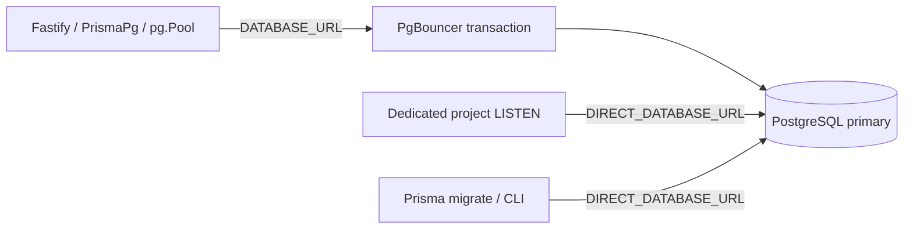

# PgBouncer: cấu hình trước staging

Cập nhật 2026-10-12. Bộ file này chuẩn bị transaction pooling cho stack **một host, một backend** hiện có. Chưa chạy Docker image hoặc PgBouncer thật trên máy phát triển; chưa chứng minh 10.000 concurrent users. Theo dõi acceptance trong [tasks](../../../../.kiro/specs/system-capacity-10000-users/tasks.md).

## 1. Thành phần và đường kết nối

| Thành phần | File | Trạng thái |
| --- | --- | --- |
| Pooler private, SCRAM, cap server hữu hạn | [INI](../../../../deploy/pgbouncer/pgbouncer.ini) | Đã kiểm tra tính nhất quán |
| Image từ source chính thức, release và SHA-256 cố định | [Dockerfile](../../../../deploy/pgbouncer/Dockerfile) | Chưa build Linux |
| Secret copy vào tmpfs, process UID/GID 10001 | [entrypoint](../../../../deploy/pgbouncer/entrypoint.sh) | Đã rà quyền và LF; chưa chạy container |
| Root Compose override + readiness | [compose.pgbouncer.yml](../../../../deploy/compose.pgbouncer.yml) | YAML parse; chưa `docker compose config` |
| Rollback direct với URL đã encode | [compose.direct.yml](../../../../deploy/compose.direct.yml) | YAML parse; chưa diễn tập |
| Ngân sách rollout | [connection-budget.json](../../../../deploy/pgbouncer/connection-budget.json) | Checker + negative tests đạt |
| Lab riêng và test runner | [compose.pgbouncer-test.yml](compose.pgbouncer-test.yml), [runner](../../../scripts/test-pgbouncer-integration.ts) | Chuẩn bị; runtime gate còn mở |



Runtime đã dùng Prisma 7 với `pg.Pool`, `DB_POOL_MAX=10` và acquire timeout 5 giây mỗi process. Không nhân pool theo số socket hay số người dùng. CLI và listener đã có đường direct riêng. Với phiên bản này, cấu hình pool nằm ở driver; xem [Prisma PgBouncer](https://www.prisma.io/docs/orm/v7/prisma-client/setup-and-configuration/databases-connections/pgbouncer). Không thêm `pgbouncer=true` theo hướng dẫn Prisma đời cũ.

Image hiện khóa PgBouncer **1.26.0** và SHA-256 source. Release có bản vá bảo mật/khả năng phục hồi; xem [changelog chính thức](https://www.pgbouncer.org/changelog.html). Base Debian và PostgreSQL 16 vẫn là tag: sau khi build/test, scan image và ghi digest bất biến vào manifest triển khai. Chưa coi source checksum là kiểm chứng toàn bộ image.

## 2. Ngân sách ban đầu

Chạy từ `backend`:

```powershell
npm run check:connection-budget
npm run test:unit:deployment
```

| Khoản | Khai báo hiện tại | Connection tối đa |
| --- | --- | ---: |
| PostgreSQL | max 100, reserved 3 | 97 khả dụng |
| API lúc rollout/drain | 1 steady + 1 surge + 1 terminating; một process/container | 30 client đến pooler |
| Dedicated LISTEN | 1/API process | 3 direct |
| Pooler lúc rollout | 1 steady + 1 surge; 30 server/alias/instance | 60 server |
| Migration/ops/external | Tổng dự phòng khai báo | 5 direct |
| Headroom | Giữ trống chủ động | 10 |
| Tổng yêu cầu | 60 + 3 + 5 + 10 | **78/97** |

Còn 19 slot ngoài headroom đã tính. Đây là upper bound khai báo, không phải connection đang mở hoặc dự báo TPS. Một pooler sống sót phải chứa toàn bộ 30 client + 20 console/client reserve; `max_client_conn=200` đáp ứng giả định đó. Cấu hình chưa tạo HA pooler hay nhiều API.

Mỗi alias có cap riêng, kể cả khi cùng trỏ đến một database; thêm alias, worker, PM2 process hoặc tăng rollout phải cập nhật manifest. Protocol prepared statements được bật với `max_prepared_statements=200`. LISTEN đi direct; trong transaction chỉ dùng `SET LOCAL` cho trạng thái tạm. Tham khảo [PgBouncer config](https://www.pgbouncer.org/config.html).

Trước bật trên staging, đọc cấu hình PostgreSQL thật bằng kết nối quản trị direct:

```sql
SHOW max_connections;
SHOW superuser_reserved_connections;
SHOW reserved_connections;
SELECT datname, usename, application_name, state, count(*)
FROM pg_stat_activity
GROUP BY datname, usename, application_name, state;
```

Manifest `reservedSlots` phải tính cả các slot dành riêng mà app không được sử dụng. Role/DB connection limits và các ứng dụng khác cũng cần được kiểm kê. Script không tự đọc database, không sửa `max_connections`, không xác nhận RAM/CPU/IO đủ. Pooler admin/client reserve là loại khác với PostgreSQL reserved slots.

## 3. Lab độc lập khi đã có Docker

Chạy từ `backend` bằng Node đã cài dependencies và generated Prisma client của repo. Lab dùng hai cổng loopback 15432/16432, database `pooler_test`, password ngẫu nhiên và PostgreSQL data trong tmpfs. Không dùng `.env` ứng dụng. Không chạy đồng thời hai lab trên cùng cổng.

```powershell
$lab = node scripts/prepare-pgbouncer-lab.mjs | ConvertFrom-Json
if ($LASTEXITCODE -ne 0) { throw 'Lab configuration failed' }
$labCompose = @('--env-file', $lab.composeEnv, '-p', 'tlu-pooler-capacity-test',
  '-f', 'docs/examples/scaling-10000/compose.pgbouncer-test.yml')
docker compose @labCompose config --quiet
if ($LASTEXITCODE -ne 0) { throw 'Invalid Compose configuration' }
docker compose @labCompose up -d --build --wait
if ($LASTEXITCODE -ne 0) { throw 'Lab startup failed' }
node "--env-file=$($lab.testEnv)" --import tsx --test scripts/test-pgbouncer-integration.ts
$testExitCode = $LASTEXITCODE
docker compose @labCompose down
if ($testExitCode -ne 0) { throw 'PgBouncer integration failed; inspect the test output' }
```

`down` ở đây chỉ áp dụng project lab nêu trên, dữ liệu lab không bền vững. Generator in đường dẫn, không in credentials. File `compose.env`, `test.env`, `users.txt` sinh trong `backend/tmp/pgbouncer-lab-*` được Git ignore; dọn đúng thư mục lab đã tạo khi không còn dùng. POSIX mode 0600/0700 có trong generator; trên Windows cần ACL tài khoản riêng vì mode POSIX không thay thế NTFS ACL.

Runner chỉ nhận ba biến `TEST_PGBOUNCER_*` từ file lab. Nó kiểm tra console/version/alias/cap trước khi tạo schema ngẫu nhiên, rồi kiểm tra:

1. Generated Prisma CRUD, interactive commit/rollback và reads đồng thời.
2. `SET LOCAL` timeout/search_path không rò sang transaction tiếp theo.
3. Adapter LISTEN thật nhận notification sau commit; rollback không phát event.
4. Named prepared statement hoạt động khi đổi backend PID và khi hai client dùng cùng tên cho SQL khác nhau.
5. Hai transaction giữ hết server cap; client thứ ba hết thời gian chờ, sau đó truy vấn phục hồi.
6. `RECONNECT pooler_test` và `WAIT_CLOSE pooler_test` phục hồi Prisma/prepared work; direct listener còn hoạt động.

Runner tự xóa schema riêng sau test. Nếu tiến trình bị kill cứng trước cleanup, kiểm tra schema `codex_pooler_<run-id>` trong **lab** trước khi dọn. Đây không phải test TLS, mất node, HA hoặc full Fastify deployment. Lab PostgreSQL16 giống base Compose; các số đo primary local trước đây dùng PostgreSQL18, cần ghi rõ khác biệt khi so kết quả.

## 4. Chuẩn bị secret cho root Compose

Chỉ thực hiện khi có credential của database hiện hữu. Dùng secret manager cung cấp `PGBOUNCER_BOOTSTRAP_DIRECT_URL` cho tiến trình Node: URL PostgreSQL đã encode user/password, host `db:5432`, database `tluscholar`. Không tự phát minh mật khẩu mới cho role đang tồn tại.

Chạy từ root workspace:

```powershell
$poolerConfig = node backend/scripts/prepare-pgbouncer-config.mjs | ConvertFrom-Json
if ($LASTEXITCODE -ne 0) { throw 'Pooler secret configuration failed' }
Remove-Item Env:\PGBOUNCER_BOOTSTRAP_DIRECT_URL -ErrorAction SilentlyContinue
$poolCompose = @('--env-file', '.env', '--env-file', $poolerConfig.composeEnv,
  '-f', 'docker-compose.yml', '-f', 'deploy/compose.pgbouncer.yml')
docker compose @poolCompose config --quiet
```

`.env` của root và `deploy/.env.production` vẫn phải được chuẩn bị theo [deploy runbook](../../../../deploy/README.md); base Compose còn cần các biến nội suy của nó. Dùng `config --quiet` để tránh in URL/secret đã merge. Helper không đọc `.env`, không kết nối PostgreSQL, không tạo role hoặc đổi mật khẩu. Output `compose.env` và `users.txt` nằm trong một thư mục private mới; giữ đường dẫn trên host triển khai hoặc chuyển qua secret store và cập nhật `PGBOUNCER_AUTH_FILE` tương ứng. Không đưa file sinh ra vào image/artifact công khai.

Userlist mặc định giữ mật khẩu hiện hữu dạng plaintext trong file private, còn trao đổi auth dùng SCRAM. Console `pooler_admin` có credential riêng ngẫu nhiên, không phải role ứng dụng. Nếu quản trị viên thay plaintext bằng SCRAM verifier, phải lấy đúng verifier của PostgreSQL, gồm salt/iterations; tự hash cùng password với salt mới không tương đương. [Định dạng auth_file và SCRAM](https://www.pgbouncer.org/config.html#authentication-file-format).

Helper từ chối password mang hình thức `md5<32hex>`/`SCRAM-SHA-256$...`, control characters, URL query/fragment và role trùng console admin để tránh cách diễn giải mơ hồ. Trường hợp deployment khác host/db/TLS cần cấu hình riêng và kiểm chứng lại, không nới helper để tự đoán topology.

Production override không publish cổng PgBouncer, sử dụng network Docker trên cùng host. Nếu tách host, bổ sung TLS có xác minh CA/hostname cho cả hai chặng; [INI TLS tham khảo](pgbouncer.ini) có thông số khác và không được mount thay trực tiếp cho bộ này. `pg_isready` ở container chỉ chứng minh khả năng trả lời giao thức; `/health/ready` của backend mới chạy probe SQL và dependency readiness.

## 5. Bật thử và quan sát

Chỉ tiếp tục sau khi lab, image scan và kiểm kê live budget đạt. Các lệnh sau là thao tác cho người vận hành trên staging đã chuẩn bị, chưa được chạy trong phiên phát triển này:

```powershell
docker compose @poolCompose build pgbouncer
if ($LASTEXITCODE -ne 0) { throw 'Pooler image build failed' }
docker compose @poolCompose up -d --wait pgbouncer
if ($LASTEXITCODE -ne 0) { throw 'Pooler readiness failed' }
docker compose @poolCompose up -d --no-deps --force-recreate --wait --wait-timeout 90 backend
if ($LASTEXITCODE -ne 0) { throw 'Backend readiness failed; inspect or roll back before accepting traffic' }
```

Đường migrations của override đi direct; thực hiện migrations theo quy trình release riêng, không dùng bài lab làm migration ứng dụng. Chạy smoke health/login/project/read-write/realtime/compile bằng fixture staging, đối chiếu các metric và error budget với baseline. Chưa bật PM2 hoặc scale API khi durable jobs/shared files và Redis gates còn mở.

Theo dõi `/health/ready`, app pool pending/acquire latency, HTTP503/DB timeout, PostgreSQL active/idle/lock waits và event delivery/revoke lag. Trên console pooler, dùng `SHOW POOLS`, `SHOW STATS`, `SHOW DATABASES` qua credential quản trị private; không đưa URL có mật khẩu vào shell history. Cần lưu các chuỗi số liệu theo thời gian, không kết luận từ một snapshot. Kiểm tra queue wait p95 cùng số timeout; server cap đạt giới hạn kèm queue tăng là tín hiệu dừng tăng tải, không tự tăng pool vô hạn.

Đặt ngưỡng rollback theo SLO staging: readiness lỗi liên tục, timeout/query error vượt baseline, nhận thiếu/sai event hoặc revoke quá giới hạn5s. Có thể bắt đầu cảnh báo queue wait p95>100ms trong5phút, nhưng điều chỉnh theo measurements và SLO; chưa phải threshold đã được kiểm chứng.

## 6. Drain và rollback về direct

PgBouncer `SIGTERM` chờ client disconnect. API có pool giữ connection lâu nên phải drain/stop API trước pooler; grace45s có thể hết hạn nếu client không đóng. [PgBouncer shutdown](https://www.pgbouncer.org/usage.html). Bộ Compose một host này cần cửa sổ gián đoạn khi rollback, không hứa zero downtime và không tự replay POST.

Budget direct với cùng process envelope là `30 + 3 + 5 + 10 = 48/97`. Nếu giữ đồng thời hai pooler peak60 server rồi mở toàn bộ direct pools, envelope thành `108/97`: không được rollout kiểu đó. Kiểm kê actual processes/connections trước khi áp dụng con số này; dừng tất cả pooler cũ và xác nhận chúng đã nhả server connection.

Chạy từ root với `$poolerConfig` và `$poolCompose` của bước4 còn hiệu lực. Giữ cùng Compose project name như lần bật, không dùng `-p` mới. Nếu có override Redis/TLS khác, giữ chúng nhất quán ở cả hai bộ lệnh.

```powershell
$directCompose = @('--env-file', '.env', '--env-file', $poolerConfig.composeEnv,
  '-f', 'docker-compose.yml', '-f', 'deploy/compose.direct.yml')
docker compose @directCompose config --quiet
if ($LASTEXITCODE -ne 0) { throw 'Invalid direct rollback configuration' }
docker compose @poolCompose stop web backend
if ($LASTEXITCODE -ne 0) { throw 'API drain/stop failed' }
docker compose @poolCompose stop pgbouncer
if ($LASTEXITCODE -ne 0) { throw 'Pooler stop failed' }
# Verify old pooler processes/connections have gone; account for any manually started replicas.
docker compose @directCompose up -d --no-deps --force-recreate --wait --wait-timeout 90 backend
if ($LASTEXITCODE -ne 0) { throw 'Direct backend startup failed' }
# Verify backend /health/ready and smoke requests before restoring ingress.
docker compose @directCompose start web
```

Không dùng đồng thời direct override và pooler override: dependency merge có thể giữ pooler trong `depends_on`. Không `down -v` hoặc xóa DB/storage để rollback. Sau rollback, dùng bộ `$directCompose` cho thao tác tiếp theo, giữ file secret an toàn cho tới khi hết nhu cầu phục hồi.

## 7. Bằng chứng hiện tại và phần chưa chạy

- Deployment unit tests: **9/9**; budget transaction **78/97**, các trường hợp surge/alias/vô hạn/INI drift bị kiểm tra.
- Secret generator QA dùng mật khẩu giả ngẫu nhiên có ký tự đặc biệt: URL/userlist khớp, console credential riêng, file được Git ignore; không đọc credential ứng dụng.
- Runner typecheck strict đạt. Lệnh test không có `TEST_PGBOUNCER_URL` thất bại có chủ ý ngay trước kết nối/DDL; không tính là integration pass.
- Chưa có Docker/PgBouncer hoặc WSL hoạt động tại máy hiện tại: chưa build image, validate bằng Compose CLI, chạy six subtests thật hoặc diễn tập rollback.
- Không thay runtime source/schema/HTTP DTO trong đợt cấu hình này. Source/build/load evidence cũ giữ nguyên giới hạn của từng run; chưa có kết quả 10k mới.

Chi tiết triển khai: [capacity report](../../../../.kiro/reports/system-capacity/10000-users-implementation.md).
